  

  
<strong>Building practical software, developer tools, and automation.</strong>

  

    <a href="https://github.com/Aariso0?tab=repositories">Repositories</a>
    ·
    <a href="https://github.com/Aariso0?tab=stars">Stars</a>
    ·
    <a href="https://github.com/Aariso0">GitHub profile</a>
  

---

## About

I build software across developer tooling, automation, AI-assisted workflows, and applications. I enjoy working close to the system, experimenting with new ideas, and turning useful experiments into practical tools.

- Interested in systems programming, Linux, AI, and automation.
- Building and exploring with Rust, C/C++, Python, Java/Kotlin, and JavaScript.
- Interested in open-source tools that solve real workflow problems.

## Technologies

  

## Recently pushed repositories

Automatically sorted by latest push. This section refreshes every six hours.

<!-- RECENT_REPOS_START -->

<<<<<<< HEAD
- **[Aariso0](https://github.com/Aariso0/Aariso0)** — No description added yet. · `Python` · pushed 03 Nov 2026, 03:03 PM IST
- **[helper](https://github.com/Aariso0/helper)** — Offline-first Android app for teachers (Kotlin, Jetpack Compose, Room). Tap-to-mark attendance, student feedback, homework sharing, paren... · `Kotlin` · pushed 03 Nov 2026, 10:57 AM IST
- **[BuyPal](https://github.com/Aariso0/BuyPal)** — BuyPal is an AI-powered autonomous shopping agent that uses live browser automation to discover products, compare prices, navigate mercha... · pushed 02 Nov 2026, 09:23 PM IST
- **[logic-layer](https://github.com/Aariso0/logic-layer)** — No description added yet. · `Python` · pushed 23 Aug 2026, 08:17 PM IST
- **[Homelabbing](https://github.com/Aariso0/Homelabbing)** — No description added yet. · pushed 07 Aug 2026, 12:53 AM IST
=======
_Run the **Update profile content** workflow once to populate this section._
>>>>>>> a26cb68 (fixed)

<!-- RECENT_REPOS_END -->

## GitHub activity

  
  

### Contribution graph

<!-- BEGIN ACTIVITY-GRAPH -->

_Run the **Generate contribution graph** workflow once to populate this section._

<!-- END ACTIVITY-GRAPH -->

---

  Thanks for stopping by. Feel free to explore my repositories.

