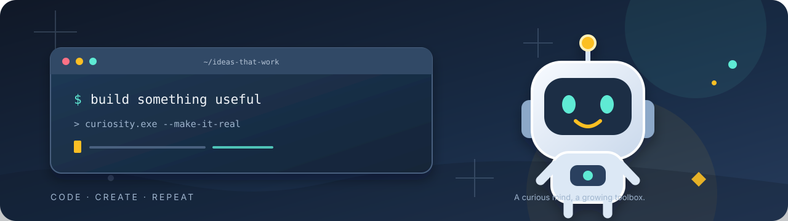

  

<table>
  <tr>
    <td width="72%" valign="middle">
      <h3>Developer · Builder · Curious by default</h3>
      
I turn interesting ideas into practical software — from low-level tools to AI-powered workflows.

      

        <a href="https://github.com/Aariso0?tab=repositories">Explore projects</a>
        &nbsp;·&nbsp;
        <a href="https://github.com/Aariso0?tab=stars">Starred projects</a>
        &nbsp;·&nbsp;
        <a href="https://github.com/Aariso0">GitHub profile</a>
      

    </td>
    <td width="28%" align="center" valign="middle">
      
    </td>
  </tr>
</table>

---

## A little about me

I'm a developer who likes understanding how things work — then building something useful with that knowledge. I enjoy moving between systems programming, desktop and mobile apps, automation, and AI tooling.

<table>
  <tr>
    <td width="50%" valign="top">
      <strong>What I like building</strong>  
      - Developer tools and system utilities 
      - Automation and agentic workflows 
      - Desktop, mobile, and web applications 
      - Experiments that grow into real projects
    </td>
    <td width="50%" valign="top">
      <strong>What keeps me curious</strong>  
      - Linux and systems programming 
      - AI, local models, and intelligent interfaces 
      - Open-source software and clean tooling 
      - Finding simpler ways to solve hard problems
    </td>
  </tr>
</table>

## My toolbox

  

  Always learning. Always tinkering. Occasionally breaking things for science.

---

## Fresh from the workbench

My five most recently pushed public projects, refreshed automatically every week.

<!-- RECENT_REPOS_START -->

- **[Buddy](https://github.com/Aariso0/Buddy)** — Buddy is a local-first meeting and lecture recorder. It captures system audio and mic as separate tracks, plus slides or screen video, th... · `Rust` · pushed 23 Nov 2026, 11:26 AM IST
- **[Project-Artinarey](https://github.com/Aariso0/Project-Artinarey)** — Artinarey is a local app for running several AI coding agents in parallel on one git project. Each agent gets its own worktree, branch, m... · pushed 23 Nov 2026, 07:25 AM IST
- **[helper](https://github.com/Aariso0/helper)** — Offline-first Android app for teachers (Kotlin, Jetpack Compose, Room). Tap-to-mark attendance, student feedback, homework sharing, paren... · `Kotlin` · pushed 19 Nov 2026, 10:17 PM IST
- **[BuyPal](https://github.com/Aariso0/BuyPal)** — BuyPal is an AI-powered autonomous shopping agent that uses live browser automation to discover products, compare prices, navigate mercha... · `Python` · pushed 19 Nov 2026, 08:23 PM IST
- **[reviewer](https://github.com/Aariso0/reviewer)** — reviewer sets up an AI pull-request reviewer on GitHub Actions from any git repository. A stdlib-only Python CLI writes the runner, promp... · `Python` · pushed 19 Nov 2026, 06:35 AM IST

<!-- RECENT_REPOS_END -->

---

## GitHub at a glance

  
  

### The contribution trail

<!-- BEGIN ACTIVITY-GRAPH -->
<picture>
  <source media="(max-width: 767px)" srcset="activity-graph-mobile.svg">
  
</picture>
<!-- END ACTIVITY-GRAPH -->

---

  <strong>Thanks for dropping by!</strong> 
  Have a look around, find something useful, and let's build cool things.

